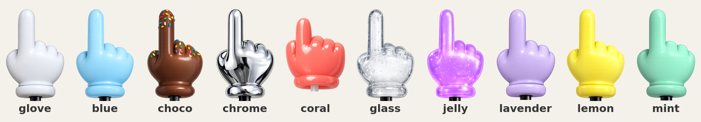

# TinyHand for Hyprland

A giant pointing hand on a stick that follows your cursor, for presentations, screen sharing and recordings: click to tap, drag to draw.

This is a Linux / [Hyprland](https://hyprland.org) port of **[TinyHand](https://github.com/nilbuild/tinyhand)** by Kamran Ahmed ([tinyhand.app](https://tinyhand.app)), a macOS app. All the credit for the idea, the look, the hand artwork, the sounds and the animation goes to the original project. This port reimplements its behaviour with Python, GTK 4 and `gtk4-layer-shell`, and bundles 10 of its 36 hands.



## Features

- The hand follows the cursor and taps when you click, with the original's arm geometry, press animation and shadow.
- Drag to draw with ink matching the hand's colour. The drawing stays until you press Esc or close the hand.
- Clicks are captured while the hand is on, so you can tap anything without triggering it. Toggle **real clicks** to let clicks reach your apps while the hand keeps tapping.
- If an external screen (projector, monitor, not mirrored) is connected, the hand opens there and moves focus and the cursor to its centre. It then follows the cursor from screen to screen.
- Tap sounds (6 to choose from), size, shadow and ink colour, set in a TOML file or from a rofi menu.
- Scrolling and hovering keep working normally: the overlay never takes input.

## Requirements

- Hyprland **0.57 or newer with the Lua config** (`hyprland.lua`). The port relies on `hyprctl eval` and the Lua `hl` API.
- Python 3.11+, PyGObject, GTK 4, `gtk4-layer-shell`, pycairo
- `rofi` (hand and settings menu), `pw-play` from PipeWire (sounds), `notify-send` (optional)

On Arch Linux:

```sh
sudo pacman -S python-gobject gtk4 gtk4-layer-shell python-cairo rofi pipewire libnotify
```

## Install

```sh
git clone https://github.com/arnorien/tinyhand-hyprland ~/tinyhand-hyprland
```

Then add the keybindings from [`examples/hyprland.lua`](examples/hyprland.lua) to your `~/.config/hypr/hyprland.lua`, adjusting the path if you cloned elsewhere. The daemon starts by itself on the first <kbd>Super</kbd>+<kbd>T</kbd>.

## Usage

| Keys | Action |
|---|---|
| <kbd>Super</kbd>+<kbd>T</kbd> | Hand on / off |
| <kbd>Super</kbd>+<kbd>Shift</kbd>+<kbd>T</kbd> | Pick a hand, sound, size, shadow (rofi) |
| <kbd>Super</kbd>+<kbd>Alt</kbd>+<kbd>T</kbd> | Real clicks on / off (the hand stays) |
| <kbd>Super</kbd>+<kbd>Ctrl</kbd>+<kbd>T</kbd> | Clear the drawing |
| <kbd>Esc</kbd> | Clear the drawing; if there is none, close the hand |
| <kbd>Super</kbd>+<kbd>Ctrl</kbd>+<kbd>Alt</kbd>+<kbd>Esc</kbd> | Emergency: release everything immediately |

While the hand is on: click to tap, drag to draw.

The same actions are available from the command line: `tinyhand.py toggle | through | clear | pick | hand NAME | quit`, and `tinyhand.py run [--activate] [--demo]` runs the daemon in the foreground (`--demo` shows the hand without capturing clicks).

## Settings

`~/.config/tinyhand/config.toml` is created on first run and reloaded live:

```toml
hand = "glove"          # glove, blue, choco, chrome, coral, glass, jelly, lavender, lemon, mint
size = 0.13             # hand height, as a fraction of the screen height (0.06 to 0.25)
shadow = true
sound = true
tap_sound = "thock"     # thock, click, pop, boop, squeak, wood
ink = "match"           # "match" (hand colour) or "#RRGGBB"
fade_seconds = 0        # 0 = the drawing stays until Esc or close; otherwise fade delay in seconds
```

## How it works

- A transparent, click-through `gtk4-layer-shell` surface on the overlay layer draws the hand (GSK render nodes, GPU-accelerated).
- While the hand is on, Lua keybindings on `mouse:272` (left click, no modifier) consume the click and append a letter to an event file in `$XDG_RUNTIME_DIR/tinyhand/`, which the daemon reads every frame. Real-click mode rebinds them as `non_consuming`.
- The cursor position comes from Hyprland's IPC socket (`cursorpos`, about 0.1 ms), and the system cursor is hidden with `cursor:invisible`.

### Safety

Capturing the left click and hiding the cursor must never outlive the daemon, so:

- a Lua timer inside Hyprland watches a heartbeat file: if the daemon stops updating it for 3 seconds (crash, `kill -9`, freeze), Hyprland removes the bindings and shows the cursor again by itself;
- <kbd>Super</kbd>+<kbd>Ctrl</kbd>+<kbd>Alt</kbd>+<kbd>Esc</kbd> does the same instantly, without going through the daemon;
- the hand turns off when the screen locks (hyprlock).

## Limitations

- Hyprland only, and only with the Lua config.
- On-screen messages and code comments are in French for now.
- With several external screens, the hand opens on the first one Hyprland lists.
- Sounds go through `pw-play`, which can add a small delay.
- Not ported from the original: the laser dot, custom hands, the toolbar (replaced by keyboard shortcuts) and the settings window (replaced by the TOML file and rofi).

## Credits

- [TinyHand](https://github.com/nilbuild/tinyhand) by Kamran Ahmed: original macOS app, hand images, sounds and animation, under the MIT licence.
- This port is also released under the MIT licence; see [LICENSE](LICENSE).
